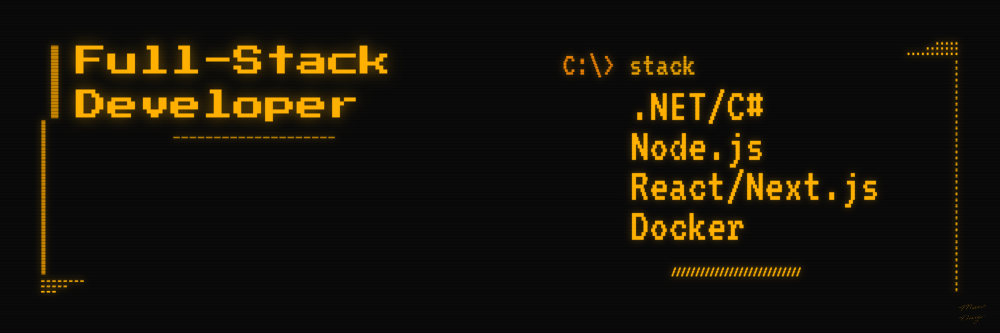

I'm a full-stack developer based in Drammen, Norway, with a strong focus on back-end architecture, clean API design and running my own production infrastructure. Right now I'm building a suite of products for small Norwegian businesses, all based on open public data.

🌐 **Portfolio:** [devrimdev.no](https://www.devrimdev.no) · 💼 [LinkedIn](https://www.linkedin.com/in/devrimsavas/) · 📄 [CV](https://github.com/devrimsavas/CV-Resume)

---

## 🛠️ What I'm building

* 🛡️ **[Leverandørvakt](https://leverandorvakt.devrimdev.no)** ([code](https://github.com/devrimsavas/LEVERANDORVAKT)): live in production. An early-warning service that follows your suppliers and customers in the Brønnøysund registers and notifies you when something important changes, with explainable risk signals and an AI assistant. *Node.js, TypeScript, Express 5, PostgreSQL, Next.js, Designsystemet*
* 📅 **[Regelvakt](https://regelvakt.devrimdev.no)** ([code](https://github.com/devrimsavas/REGELVAKT)): live as a pilot. Enter an organization number, and a versioned rules engine shows which official obligations and deadlines apply to an ENK or AS, with calendar export, email reminders and an AI assistant that answers with numbered sources. About 370 unit and integration tests plus Playwright e2e tests with accessibility checks. *TypeScript, Express 5, PostgreSQL, Next.js, Designsystemet*
* 🚢 **Tollvakt** ([code](https://github.com/devrimsavas/TOLLVAKT)): in development. AI-assisted customs classification for Norwegian importers: describe a product in your own words and get the most likely customs codes with their reasoning, plus duty and VAT for the chosen origin country. A Python ETL pipeline loads 17 datasets from Tolletaten's open data, with full-text and semantic search (pgvector). *TypeScript, Express, PostgreSQL, pgvector, Python, Gemini, Ollama*

## ⚙️ Infrastructure

* 🐳 Everything runs in Docker Compose on my own VPS and a self-hosted Ubuntu home server, published through Cloudflare Tunnel with no open ports, with nightly database backups
* ✅ Automated tests and GitHub Actions CI on every project

---

## 🚀 More projects

| Project | Description | Tech |
|---|---|---|
| [**NorskHandverk**](https://github.com/devrimsavas/NorskHandverk) ([live](https://norsk-handverk.vercel.app)) | Full-stack e-commerce platform for Norwegian handcrafts with Stripe payments (idempotent checkout, webhooks), dynamic cart and relational data modeling | .NET 9, Next.js 16, PostgreSQL, Stripe |
| [**Aurora Trails**](https://github.com/devrimsavas/NorthernTourGuide) | Booking platform for Arctic adventure tours in Northern Norway. Overbooking-safe bookings with row-level locking, JWT auth with automatic token refresh, role-based customer and guide flows, live weather and aurora forecasts, and 43 automated tests in GitHub Actions | Django REST Framework, PostgreSQL, Angular, Tailwind |
| [**Order Store**](https://github.com/devrimsavas/mongorabbit) | Asynchronous order processing: orders are saved to MongoDB and published to RabbitMQ, where a background consumer reserves stock atomically, with a dead-letter queue for failed messages | ASP.NET Core 9, MongoDB, RabbitMQ, Angular |
| [**GraphQLBlogAPI**](https://github.com/devrimsavas/GraphQLBlogAPI) | GraphQL blog API with JWT authentication and resolver-level role-based authorization | ASP.NET Core, HotChocolate, GraphQL, EF Core |
| [**BIT4 – 4-bit CPU Emulator**](https://github.com/devrimsavas/CPU-4-BIT-EMULATOR) | Handcrafted 4-bit computer built from scratch: custom CPU, ALU, RAM, VPU, assembler and instruction set, without frameworks | C#, WinForms |
| [**DOSBox-X Toolkit**](https://github.com/devrimsavas/dos_box_utils) | Python toolset for live DOSBox-X processes: memory trainer, VGA and CGA video-memory viewers, and a snapshot diff tool for locating game addresses | Python, Tkinter |

---

## 🧰 Tech Stack

**Frontend**  

**Backend**  

**Databases**  

**Cloud & DevOps**  

---

## 👋 About me

* 🧑‍🏫 Former instructor at JobLoop and mentor at Noroff, teaching C#, ASP.NET, Node.js and JavaScript
* 🌍 Fluent in 6 languages: English, Norwegian, Turkish, German, French, Russian

## 📬 Get in touch

I'm open to new opportunities and collaborations. Feel free to reach out!

- 📧 **devrimsavasyilmaz@gmail.com**
- 💼 [LinkedIn](https://www.linkedin.com/in/devrimsavas/)
- 📄 [CV / Resume](https://github.com/devrimsavas/CV-Resume)
